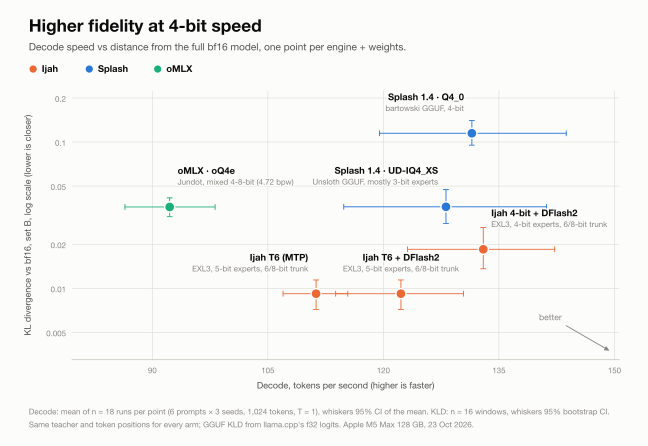
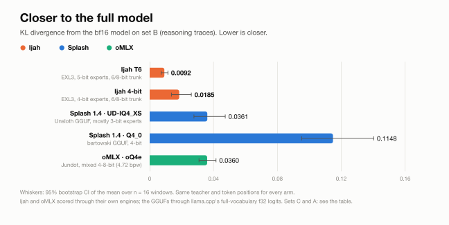
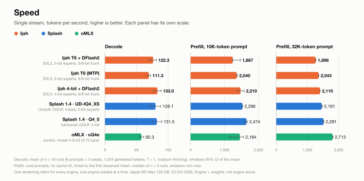

<p align="center"></p>

# Ijah

**A raw-Metal inference engine for Qwen3.8-Flash-Next and Swift-1.5 on the Apple M5 Max. It runs higher-fidelity EXL3
weights at the speed of 4-bit engines.**

<p align="center">
  <picture>
    <source media="(prefers-color-scheme: dark)" srcset="assets/charts/hero-dark.svg">
    
  </picture>
</p>

## Why

On a 128 GB Mac the weights take up most of the memory, so what matters is how much of the full model each byte keeps.
Ijah uses EXL3 trellis weights (5-bit experts, 6/8-bit trunk), which keep far more of the full model per byte than
4-bit GGUF or MLX weights, and decodes them inside its fused Metal kernels.

- **Closer to the full model.** Ijah's published pack has a KL divergence from bf16 of **0.0092** on our reasoning set,
  against **0.036** for the UD-IQ4_XS GGUF and oMLX's oQ4e, and **0.115** for a plain Q4_0 GGUF. It picks the same
  top token as bf16 97.5% of the time.
- **Comparable speed.** With the DFlash2 drafter the published pack decodes at **122 tok/s**, against 128-132 for
  Splash 1.4 and 92 for oMLX. With 4-bit experts Ijah reaches **133 tok/s**, level with Splash's fastest file while
  staying 2-6x closer to bf16.

Ijah is an Objective-C++ core and Metal kernels with no MLX in the serving path. It serves an OpenAI- and
Anthropic-compatible HTTP API (streaming, tool calls, structured output, vision) and has a prefix cache that survives
restarts.

## Quick start

You need an **Apple M5** Mac on **macOS 27** (Ijah uses the Metal 4 tensor units; M1 to M4 do not work), about
**90 GB of free unified memory** for one model at the full 262K context, **185 GB of disk** (83 GB pack plus the 102 GB
n-gram table), the Xcode command-line tools with the Metal toolchain (`xcodebuild -downloadComponent MetalToolchain`)
and Python 3.11 or newer.

With Homebrew (once the tap is published):

```sh
brew install publicExcess/ijah/ijah    # builds the engine, the server's Python env and the `ijah` command
```

Or from source:

```sh
git clone https://github.com/publicExcess/ijah && cd ijah
make venv && make                      # Python env, then build/libengine.dylib, build/engine.metallib and the CLIs
export PATH=$PWD/tools:$PATH           # the `ijah` command
```

Then download the model and start the server:

```sh
ijah download base drafter ngram       # ~83 GB pack, 1.2 GB DFlash2 drafter, 102 GB n-gram table, into ~/.cache/ijah
ijah doctor                            # checks the Mac, the build, the packs, the key and the port
ijah serve start                       # makes ~/.config/ijah/api-key on first start, waits until /health answers
ijah serve status                      # also: stop, restart, log [N]; `brew services start ijah` runs it at login
```

```sh
curl -s http://127.0.0.1:8140/v1/chat/completions \
  -H "Authorization: Bearer $(cat ~/.config/ijah/api-key)" -H 'Content-Type: application/json' \
  -d '{"model": "Qwen3.8-Flash-Next-native", "stream": true,
       "messages": [{"role": "user", "content": "Write a haiku about unified memory."}]}'
```

The server listens on 127.0.0.1 only, and every `/v1` request needs the key. `ijah download` pins every revision; the
same files can be fetched by hand with `hf download` (the repos are in the table below).

**DFlash2 drafter** (on by default, about +7-15% decode at short context): every model id uses Inco's draft model when
it is in `~/.cache/ijah/drafters`. Without it the server drafts with the model's own MTP head and says once in the log
how to get it. `ijah serve start -- --drafter none` forces the MTP head; the older `-dflash` model ids still work as
names for the same model with the drafter required.

**Swift-1.5** (UkisAI's fine-tune, **non-commercial use only**): download its pack, link it to the base pack's files
(the n-gram table and about 79 GB of identical expert files, then stored and loaded once), and start it by id.

```sh
ijah download swift && ijah link
ijah serve start Swift-1.5-Flash-Next-native
ijah serve start all                   # or both models in one process; requests pick one with "model"
```

**4-bit pack** (faster, lower fidelity; the T6 pack is the preferred one): `ijah download base-4bit`, then
`ijah serve start Qwen3.8-Flash-Next-native-4bit`.

Server flags go after `--`, for example `ijah serve start -- --ctx 65536 --cache-disk 20GB` (`ijah` wraps
`tools/serve.sh`, which takes the same arguments). `docs/server.md` lists every flag and setting.

## Models

| what | Hugging Face | size | notes |
|---|---|---|---|
| Qwen3.8-Flash-Next, Ijah T6 pack | [SiliconSpecies/Qwen3.8-Flash-Next-EXL3-Ijah](https://huggingface.co/SiliconSpecies/Qwen3.8-Flash-Next-EXL3-Ijah) | 83 GB | EXL3 5-bit experts, 6/8-bit trunk. Qwen licence |
| Swift-1.5-Flash-Next, Ijah T6 pack | [SiliconSpecies/Swift-1.5-Flash-Next-EXL3-Ijah](https://huggingface.co/SiliconSpecies/Swift-1.5-Flash-Next-EXL3-Ijah) | 83 GB | Same format. Swift Open License 1.0, non-commercial |
| n-gram embedding table (both models) | [SiliconSpecies/Qwen3.8-Flash-Next-ngram-table](https://huggingface.co/SiliconSpecies/Qwen3.8-Flash-Next-ngram-table) | 102 GB | bf16, Qwen's own, unchanged |
| Qwen3.8-Flash-Next, Ijah 4-bit pack | [SiliconSpecies/Qwen3.8-Flash-Next-EXL3-Ijah-4bit](https://huggingface.co/SiliconSpecies/Qwen3.8-Flash-Next-EXL3-Ijah-4bit) | 67 GB | Sushi's 4-bit EXL3 experts, the same 6/8-bit trunk. Faster, with 1.5-2x the KLD: **the T6 pack is preferred**. Qwen licence |
| DFlash2 draft model (used by default) | [incoai/Qwen3.8-Flash-Next-DFlash2](https://huggingface.co/incoai/Qwen3.8-Flash-Next-DFlash2) | 1.2 GB | Inco's 0.6B block drafter. Apache-2.0 |

The **Ijah 4-bit** pack in the charts is the 4-bit pack above (called K4s-T6 in the docs).

## What's new (v0.2)

- **DFlash2 by default, with an exact verify gate.** Every model id loads Inco's 0.6B drafter next to the model's own
  MTP head when the drafter is downloaded, and falls back to the MTP head when it is not. The earlier public version had
  a bias: whether a draft was verified could depend on the drafted token itself, which shifts the sampled distribution.
  That is fixed. The decision now never depends on the drafted token, which a 2-million-sample host test and a GPU
  distribution check confirm. Block drafts stop past 8K tokens of context, because they help at short context (+7-15%
  decode) and break even at 8-32K.
- **Grouped routed-expert verify kernels.** When several rows are verified at once, each expert's weights are read
  once per verify cycle instead of once per row. The output is bit-identical.
- **The `ijah` command and a Homebrew tap**: `ijah serve`, `ijah download` (pinned revisions), `ijah link`,
  `ijah models`, `ijah doctor`; `brew install publicExcess/ijah/ijah` and `brew services start ijah`.
- **The 4-bit pack is published** (see Models); the T6 pack stays the preferred one.
- **Opt-in lookahead gate** (`--dflash-gate 2`), following Splash's verify-row selection.
- **Fixes.** `--models all` loads the base and Swift-1.5 models (each with its drafter). Each model id has its own
  drafter. A missing required drafter is a clear error at start, and a request for an id the server does not serve
  (or for the drafter where it is not loaded) is a 400 that says what to do. The RAM watchdog stops the whole server
  process tree. `tools/gguf_logits.cpp` and `tools/kld_gguf.sh` reproduce the GGUF KLD numbers below.

## How we measured

<p align="center">
  <picture>
    <source media="(prefers-color-scheme: dark)" srcset="assets/charts/kld-dark.svg">
    
  </picture>
</p>
<p align="center">
  <picture>
    <source media="(prefers-color-scheme: dark)" srcset="assets/charts/speed-dark.svg">
    
  </picture>
</p>

**Quality.** Teacher-forced KL divergence from the bf16 model over the full vocabulary, with the same teacher and the
same token positions for every arm. Set B is reasoning traces (16 windows) and is the one we trust most. Set C is a 32K-token
code and prose context (4 windows). Set A is wikitext-2 (16 windows). Ijah and oMLX were scored through their own
engines. The GGUFs were scored from llama.cpp's full-vocabulary f32 logits, not through Splash's kernels.

| engine + weights | KLD B | KLD C | KLD A | top-1 B |
|---|---:|---:|---:|---:|
| Ijah T6 (EXL3, 5-bit experts, 6/8-bit trunk) | **0.0092** | **0.0148** | **0.0332** | **97.5%** |
| Ijah 4-bit (EXL3, 4-bit experts, 6/8-bit trunk) | 0.0185 | 0.0236 | 0.0513 | 96.6% |
| UD-IQ4_XS GGUF (Unsloth; mostly 3-bit experts, 8-bit trunk) | 0.0361 | 0.0539 | 0.1032 | 94.7% |
| oQ4e (Jundot; mixed 4-8-bit, 4.72 bpw) | 0.0360 | 0.0780 | 0.1277 | 93.8% |
| Q4_0 GGUF (bartowski) | 0.1148 | 0.1803 | 0.2614 | 89.0% |

**Speed.** One streaming OpenAI-compatible client for every engine, one engine loaded at a time, sampling at
temperature 1.0, top-p 0.95, top-k 20, with thinking on at medium effort. <!-- speed-n -->Decode: 6 prompts (code, maths, prose) x 3 seeds, 1,024 generated tokens each. We report the mean with a 95% confidence interval. Prefill: cold 10K and 32K-token prompts with no cache hit, 3 runs each, timed to the first streamed token, as the median with the min-max range.<!-- /speed-n -->
Engines: Ijah T6 and Ijah 4-bit with MTP and the DFlash2 drafter (the default since v0.2), and Ijah T6 with MTP alone
(`--drafter none`);
Splash 1.4.0 (source build) at its defaults, which include its DFlash2 drafter and int8 KV; oMLX 0.7.1.dev1 with MTP
at depth 2 and INT8-activation prefill.
Machine: Apple M5 Max (40-core GPU), 128 GB, macOS 27, 23 October 2026.

<!-- speed-table -->
| engine + weights | decode tok/s (mean, 95% CI) | prefill 10K tok/s (median, min-max) | prefill 32K tok/s (median, min-max) |
|---|---:|---:|---:|
| Ijah T6 + DFlash2: EXL3, 5-bit experts, 6/8-bit trunk | 122.3 [113.8, 130.4] | 1,867 (1,858-2,202) | 1,898 (1,884-1,907) |
| Ijah T6 (MTP): EXL3, 5-bit experts, 6/8-bit trunk | 111.3 [107.0, 115.4] | 2,040 (2,037-2,071) | 2,043 (2,039-2,050) |
| Ijah 4-bit + DFlash2: EXL3, 4-bit experts, 6/8-bit trunk | 133.0 [123.1, 142.2] | 2,210 (2,059-2,370) | 2,110 (2,106-2,113) |
| Splash 1.4 · UD-IQ4_XS: Unsloth GGUF, mostly 3-bit experts | 128.1 [114.9, 141.2] | 2,296 (2,295-2,301) | 2,191 (2,188-2,217) |
| Splash 1.4 · Q4_0: bartowski GGUF, 4-bit | 131.5 [119.5, 143.7] | 2,474 (2,401-2,511) | 2,281 (2,266-2,293) |
| oMLX · oQ4e: Jundot, mixed 4-8-bit (4.72 bpw) | 92.3 [86.4, 98.2] | 2,184 (1,744-2,342) | 2,713 (2,701-2,732) |
<!-- /speed-table -->

## Limitations

- **Speed parity, not a speed win.** With 4-bit experts Ijah runs at about the speed of the other 4-bit engines. Its
  lead is fidelity: the published 5-bit pack is closer to bf16 and somewhat slower than the 4-bit packs. Prefill is not
  a lead either: Splash is fastest at 10K tokens and oMLX at 32K.
- **Engine plus weights.** Each engine runs its own weight format, so the comparison is of engine plus weights, not of
  engines alone. The packs differ in size too: the GGUFs store a roughly 4-bit n-gram table, Ijah's is bf16.
- **One machine, synthetic prompts.** All numbers come from one M5 Max, and run-to-run drift is about 3-8%. Real agent
  sessions mix prefill and decode differently.
- **KLD caveats.** KL divergence measures closeness to bf16, not task accuracy. Set C has only 4 windows, so treat it
  as indicative. The GGUF numbers come from llama.cpp's logits, so they show the weights and not Splash's kernels.
- **Narrow scope.** Ijah runs one model family on M5 GPUs only and serves one request at a time by default.
  Flash-Next previews the Qwen4 architecture, so expect changes. This is research code with no support promise.

## Credits and licence

Ijah is Apache-2.0 (`LICENSE`). It builds on other people's work. The licences are in `NOTICE` and
`THIRD_PARTY_NOTICES.md`, and the source comments name each upstream file.

- [Sushi](https://github.com/beamivalice/sushi) (Theinruj Toranavikrai, David Dalcu; MIT): the EXL3 MoE prefill
  kernels and the pipelined gated-delta scan are ported from it. Its EXL3 decode, QSA selection and NAX layouts shaped
  ours. The packs reuse its MTP head, embeddings, routers, norms and vision tower.
- [exllamav3](https://github.com/turboderp-org/exllamav3) (turboderp; MIT): the EXL3 trellis format and its encoder.
- [MLX](https://github.com/ml-explore/mlx) (Apple; MIT): the vendored NAX GEMM and attention headers, and math helpers.
- [mlx-vlm](https://github.com/Blaizzy/mlx-vlm) (Prince Canuma; MIT): the reference model and the image preprocessing.
- [oMLX](https://github.com/jundot/omlx) (jundot; Apache-2.0): our gated-delta scan derives from its kernel, and our
  INT8-activation prefill follows its approach.
- [Splash](https://github.com/incoai/splash) and [Inco](https://inco.ai/blog/dflash2/) (Apache-2.0): the DFlash2 draft
  model, and the design ideas behind our verify-row choice and lookahead gate (Splash 1.4.0, PR #487).
  [z-lab DFlash](https://github.com/z-lab/dflash): the block-drafter architecture and generation loop.
- [TensorFold](https://github.com/ashhart/TensorFold): the MTP copy-draft rule.
- [Splish](https://github.com/publicExcess/splish): the pruned draft vocabulary.
- [llama.cpp](https://github.com/ggml-org/llama.cpp) (MIT): the GGUF logits for the quality comparison. Comparison
  weights by Unsloth (UD-IQ4_XS), bartowski (Q4_0) and Jundot (oQ4e).
- The Qwen team for Qwen3.8-Flash-Next (Qwen licence) and UkisAI for Swift-1.5 (Swift Open License 1.0,
  non-commercial).
