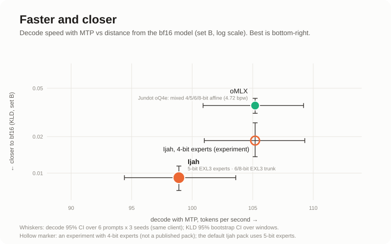
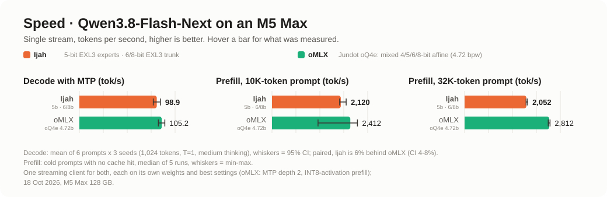
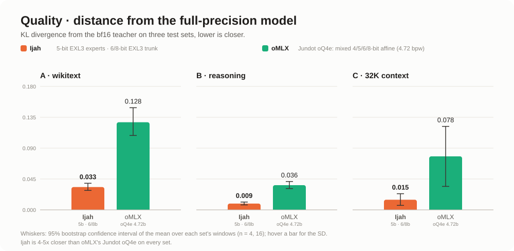

<p align="center"></p>

# Ijah

Ijah is an LLM inference engine for Apple M5 written from scratch on raw Metal: an Objective-C++ core, Metal kernels,
and no MLX in the serving path. It runs one model family, **Qwen3.8-Flash-Next** and its fine-tune **Swift-1.5
Flash-Next**, and serves them over an OpenAI- and Anthropic-compatible HTTP API.

- **EXL3 trellis weights**: 5-bit experts and a 6/8-bit trunk, decoded on the fly inside fused MoE and GEMV kernels.
- **MTP speculative decoding** with the model's own multi-token-prediction head (draft depth 2 by default), and an
  opt-in **DFlash2 block drafter** in the same loop for about 7-10% more decode speed.
- **Chunked prefill** on the M5 GPU's tensor units (NAX), with QSA sparse attention for long contexts (262K window).
- **Prefix cache** in RAM and optionally on SSD. Conversations survive server restarts, and **shared-prefix
  snapshots** let a new session reuse the long system prompt and tool block that earlier sessions already prefilled.
- **Vision**: the model's own vision tower runs in the engine, and image parts work in chat requests.
- **Server**: `/v1/chat/completions`, `/v1/completions`, `/v1/messages`, `/v1/models`, streaming, tool calls,
  structured output (`response_format`, forced `tool_choice`), logprobs, logit bias and penalties, and two models in
  one process.

## Requirements

- An **Apple M5** Mac (Ijah needs the Metal 4 tensor units; M1 to M4 are not supported) on **macOS 27**.
- **About 90 GB of free unified memory** for one model at the full 262K context (~81 GB of weights plus ~28 KB per
  context token). In practice that means a 128 GB machine with no other model loaded.
- About 185 GB of disk for one model: the 83 GB pack plus the 102 GB n-gram embedding table, which both models
  share. A second model adds about 4 GB once the shared files are linked (see below), 83 GB otherwise. The optional
  DFlash2 drafter adds about 1.2 GB on disk and about 1 GB of memory when enabled.
- Xcode command-line tools with the Metal toolchain (`xcodebuild -downloadComponent MetalToolchain`), and Python 3.11
  or newer for the server.

## Quick start

```sh
git clone https://github.com/publicExcess/ijah && cd ijah
make venv                       # .venv with requirements.txt (python3.11+)
make                            # build/libengine.dylib, build/engine.metallib, CLIs and test binaries

# a pack: the weights, tokenizer and chat template (~83 GB) ...
hf download SiliconSpecies/Qwen3.8-Flash-Next-EXL3-Ijah \
  --local-dir ~/.cache/ijah/packs/Qwen3.8-Flash-Next-EXL3-Ijah
# ... plus the model's n-gram embedding table (102 GB, read from the SSD, never loaded into GPU memory)
hf download SiliconSpecies/Qwen3.8-Flash-Next-ngram-table ngram_table.bin \
  --local-dir ~/.cache/ijah/packs/Qwen3.8-Flash-Next-EXL3-Ijah

tools/serve.sh start            # creates ~/.config/ijah/api-key on first start; waits until /health answers
tools/serve.sh status           # also: stop, log [N], models
```

```sh
curl -s http://127.0.0.1:8140/v1/chat/completions \
  -H "Authorization: Bearer $(cat ~/.config/ijah/api-key)" -H 'Content-Type: application/json' \
  -d '{"model": "Qwen3.8-Flash-Next-native", "stream": true,
       "messages": [{"role": "user", "content": "Write a haiku about unified memory."}]}'
```

The server binds to 127.0.0.1 only, and every `/v1` request needs the key.

**Swift-1.5** (UkisAI's fine-tune; Swift Open License 1.0, **non-commercial use only**): download
`SiliconSpecies/Swift-1.5-Flash-Next-EXL3-Ijah` the same way, put the same `ngram_table.bin` in its folder (a hard
link saves 102 GB: `ln ~/.cache/ijah/packs/Qwen3.8-Flash-Next-EXL3-Ijah/ngram_table.bin
~/.cache/ijah/packs/Swift-1.5-Flash-Next-EXL3-Ijah/`), and start with
`NE_MODEL=Swift-1.5-Flash-Next-native tools/serve.sh start`.

`NE_MODEL=all` serves both models from one process. Most of the two packs is identical (the routed experts and more,
about 79 GB), and the engine maps those files once only when they are the same files on disk. Link them first:
`tools/link_shared_packs.py ~/.cache/ijah/packs/Qwen3.8-Flash-Next-EXL3-Ijah ~/.cache/ijah/packs/Swift-1.5-Flash-Next-EXL3-Ijah`.
It hard-links only byte-identical files (Swift-1.5's changed trunk files have the same names and sizes but different
contents, so they are left alone). Without it, memory use roughly doubles and the 96 GB figure below does not hold.

## Configuration

| setting | default | what it does |
|---|---|---|
| `IJAH_PACKS` | `~/.cache/ijah/packs` | where model ids find their packs (`server/models.json`) |
| `IJAH_PACK`, `IJAH_GOLDEN_PACK` | the Qwen3.8 pack | the pack the tests and tools use |
| `IJAH_PY` | `.venv/bin/python` | the Python the scripts use |
| `IJAH_KEY_FILE` | `~/.config/ijah/api-key` | the API key (`tools/serve.sh keygen` writes one; it is never printed) |
| `NE_MODEL` | `Qwen3.8-Flash-Next-native` | the model id(s) to serve: an id, `ID1,ID2`, or `all` |
| `NE_SERVE_PORT` | `8140` | the port |
| `IJAH_LOCK_SCRIPT` | unset | an optional machine-wide lock for heavy jobs (`tools/machine-lock.sh` works) |
| `NEED_GB` | 85 (96 for two models) | the server refuses to start with less free memory than this |

Runtime knobs inside the engine and server keep their `NE_` prefix (from the engine's working name); the settings
added for the public release use `IJAH_`.

Server flags go after `--`, for example `tools/serve.sh start -- --ctx 65536 --cache-disk 20GB`:

- `--ctx N`: the context window, which is also the reply cap (default 262144).
- `--mtp N` (default 2; 0 turns MTP off) and `--mtp-policy auto|always|never`.
- `--drafter mtp|dflash2` (default `mtp`): draft with Inco's DFlash2 block drafter inside the MTP loop. Needs
  `--drafter-path DIR` (the draft model, see the section below), takes `--dflash-kmax N` (default 5, at most 5 in this
  build) and `--dflash-bits 8|4` (default 8). `--mtp N` is the loop depth, so it must be at least kmax.
- `--allow-any-model`: on a single-model server, let a request name any model and get the default one. Off by default:
  an unknown name is a 400 that lists the ids served, in both directions, so a drafter run cannot silently be a
  control run (docs/server.md 13).
- `--effort xhigh|medium|low`: the reasoning effort for requests that do not set one.
- `--cache-ram 8GB`, `--cache-disk 0` (for example `20GB` turns the SSD tier on), `--cache-dir`.
- `--slots N`: concurrent requests per model. Each extra slot holds a full KV cache (~7 GB at 262K).
- `--prefill-int8` (opt-in): int8 activations for the trunk in prefill. About 3-4% faster cold prefill; the quality
  change is within noise on two test sets and slightly worse on one (docs/prefill.md 4f). It is off by default.
- `--pack DIR`: serve a pack directory directly instead of looking up the model id.

`docs/server.md` covers the rest: the prefix cache, shared-prefix snapshots, the supervisor that restarts the server
after a crash, and the request extensions.

## How it compares

<p align="center"></p>
<p align="center"></p>
<p align="center"></p>

In short, against the two engines we ran head to head: **oMLX** with Jundot's Qwen3.8-Flash-Next-oQ4e, and **Sushi**
with its own Sushi-4bpw pack. All three on one streaming client, the same prompts and seeds, each on its own weights
and best settings.

- **Quality:** Ijah is 4-5x closer to the bf16 model than oMLX on all three test sets, and 1.7-2x closer than Sushi.
- **Decode:** Ijah is **1.16x Sushi** (95% CI 1.12-1.20, 18 of 18 pairs: 98.9 vs 85.8 tok/s), and about 6% behind oMLX
  (0.94x, CI 0.92-0.96, 2 of 18 pairs; 105.2 tok/s) with its 5-bit experts. An experiment with 4-bit experts (sushi's
  4-bit expert shards with Ijah's trunk; not a published pack) matches oMLX's speed.
- **Cold prefill:** Ijah is behind oMLX, by about 12% at 10K tokens and about 27% at 32K. It is about 5% ahead of Sushi
  at 10K (2,120 vs 2,014) and level with it at 32K (2,052 vs 2,026).
- **Memory:** in the same run the engine processes peaked at **16 GB** for Ijah, 78 GB for oMLX and 69 GB for Sushi.
  Ijah keeps a bounded RAM cache (8 GB) in front of an SSD tier and reads the 102 GB n-gram table from disk, so it
  serves the full 262K window without holding the weights in memory.
- **Agent sessions:** later turns of a conversation start in about 0.2 s (exact prefix reuse). A new session's first
  turn starts in about 0.3 s when an earlier session already sent the same tool block and system prompt
  (shared-prefix snapshots).

### DFlash2 drafter (opt-in, +7-10% decode)

Inco's **DFlash2** is a 0.6B block-diffusion draft model: one pass proposes a whole block of tokens, keeps the top 16
candidates per position, and a small selector traces one coherent path through them. In Ijah it is a **second drafter
inside the MTP loop, not a replacement for it** - the native MTP head drafts the rounds the drafter's context cannot
reach (a prompt shorter than 512 rows, copy-rule rounds) and stays in step so it can take over.

Start it with the model id that asks for it:

```sh
hf download incoai/Qwen3.8-Flash-Next-DFlash2 --local-dir ~/.cache/ijah/drafters/Qwen3.8-Flash-Next-DFlash2
tools/serve.sh start -- --mtp 5 --drafter dflash2 \
  --drafter-path ~/.cache/ijah/drafters/Qwen3.8-Flash-Next-DFlash2
# requests then send "model": "Swift-1.5-Flash-Next-native-dflash"
```

Measured on the same client as the charts (6 prompts x 3 seeds, 1,024 tokens, T=1, medium thinking), paired by prompt
and seed: **120.4 tok/s against 112.4 and 108.9** for MTP depth 2, ratios **1.067 [1.036, 1.097]** (13 of 18 pairs) and
**1.101 [1.069, 1.132]** (17 of 18). By prompt: maths +14%, reasoning prose +13%, parser code +11%, LRU code +2%,
climate prose +1%, and low-acceptance prose **-3%** - the one prompt that loses.

This build instantiates the verify kernels to 6 rows, so `--dflash-kmax` tops out at 5 (verify runs kmax + 1 rows);
deeper verify is built and measured in development, not here. Off by default: a server started without `--drafter` has
no drafter, advertises no drafter id, and refuses a request that asks for one.

### How we measured

- **Machine:** Apple M5 Max (40-core GPU), 128 GB, macOS 27.0.1. One engine loaded at a time, nothing else running.
- **Compared against:** oMLX 0.7.1.dev1 with Jundot's Qwen3.8-Flash-Next-oQ4e (mixed 4–8-bit, 4.72 bits per weight),
  using tuned settings: MTP at depth 2 and INT8-activation prefill. Sushi with its own `Qwen3.8-Flash-Next-Sushi-4bpw`
  pack (4-bit experts, 8-bit trunk) at its default settings, MTP on. Ijah ran its default T6 pack (5-bit EXL3 experts,
  6/8-bit trunk) with MTP at depth 2. Each engine uses its own weight format, so the numbers compare
  **engine + weights**, not the engines alone. The three packs sit at different quality and size points, which is why
  the quality chart is shown beside the speed chart.
- **Same client for all three:** one streaming OpenAI-compatible client, the same prompts and seeds, sampling at
  temperature 1.0 / top-p 0.95 / top-k 20, thinking on at medium effort.
- **Decode:** 6 prompts (code, maths, prose) × 3 seeds, 1,024 generated tokens each. We report the mean with a 95%
  confidence interval, and compare the engines pair by pair on the same prompt and seed.
- **Prefill:** cold prompts of 10K and 32K tokens with no cache hit, 5 runs each, timed to the first streamed token
  over HTTP. We report the median with the min–max range.
- **Quality:** KL divergence between each engine's next-token distribution and the unquantised (bf16) model's, over
  the full vocabulary with teacher forcing. Three test sets: A, wikitext-2 (16 windows); B, reasoning traces (16
  windows); C, 32K-token code context (4 windows). Error bars are 95% bootstrap intervals over windows.

The charts are pre-rendered. `tools/make_charts.py` redraws them from the per-window results in `data/charts/`.

## How the packs were made

The published packs start from Qwen's bf16 weights (and UkisAI's for Swift-1.5), quantized with our own EXL3
converter, which follows exllamav3's trellis method:

- **Routed experts:** 5 bits per weight. Calibration is a whole-model activation-count importance matrix over 280K
  tokens, and the encoding uses LDLQ on the rotated Hessian.
- **Trunk:** the attention, Gated DeltaNet and shared-expert projections at 6 bits, with full Hessians captured layer
  by layer. The hyper-connection up-mixes and per-layer-embedding projections are at 8 bits, and the final mixer stays
  in bf16.
- **From Sushi's 4bpw pack** (credited in the model cards): the MTP head and its experts, the embeddings, lm_head,
  routers, norms and vision tower.
- **The n-gram embedding table** is Qwen's own, unchanged.

The conversion tools are not part of this first release; they are planned for a later version.

## Tests

```sh
make test-cpu     # CPU only: chat layer, sampling, grammar, prefix cache, HTTP API on a mock engine, supervisor
make test         # core self-tests on the GPU (light) and the MTP accept rules; pack-dependent parts skip
```

The CPU tests read the packs' tokenizer and chat template, and the small files are enough. Run
`hf download SiliconSpecies/<repo> --include '*.json' '*.jinja' --local-dir ~/.cache/ijah/packs/<repo>` for both
repos. Without them those tests report SKIP. The whole-model tests (`tests/server/*_job.sh`, `make test-quality`, ...)
load the full model. Some of them compare against an MLX reference: `requirements-ref.txt`, plus EXL3 reference
modules that are not part of this repository (see `docs/reference.md`).

## Repository layout

- `core/`: device, pack loader, recorder and C API.
- `kernels/`: the Metal kernels.
- `models/flash_next/`: the layer graph, MTP, prefill and vision.
- `server/`: the HTTP server, chat layer and prefix cache.
- `tools/`, `tests/`: tooling and tests.

The design is in `ARCHITECTURE.md`. The `docs/` notes are the engineering notebooks from development, with
measurements, dead ends and traps, kept as written (the run logs they cite are not included). Their `lab-*` names are the work areas the engine was built in.
They call packs by their internal names: K5-T6 is the published Qwen3.8 pack and Swift-1.5-...-T6 the published Swift
pack. K5 and K5-a16 are the earlier 8-bit-trunk packs, which are not published.

## Limitations

- **One machine.** All numbers come from a single M5 Max; other configurations will differ. Run-to-run drift from
  temperature is about 3–8%, so we interleave engines and compare in pairs. Differences under ~1% are not resolvable.
- **Engine + weights, not engine alone.** Ijah's quality lead comes largely from its EXL3 weights. oMLX's decode and
  prefill lead comes partly from its cheaper-to-unpack 4-bit weights. oMLX was run with settings we chose, not tuned
  by its authors.
- **Synthetic, single-turn benchmarks.** Real agent sessions mix prefill and decode differently, and their wall-clock
  time depends mostly on how much the model writes.
- **Few long-context windows.** Set C has only 4 windows, so its intervals are wide.
- **KL divergence is not task accuracy.** It measures closeness to the unquantised model, not benchmark scores.
- **Narrow scope.** Ijah runs only Qwen3.8-Flash-Next and its Swift-1.5 fine-tune, needs an Apple M5 GPU and ~90 GB of
  unified memory, and serves one request at a time by default. Flash-Next is a preview of the Qwen4 architecture, so
  expect changes. This is research code with no support promise.

## Credits

Ijah builds on other people's work. The licences and details are in `NOTICE` and `THIRD_PARTY_NOTICES.md`, and the
source comments name each upstream file.

- [sushi](https://github.com/beamivalice/sushi) (Theinruj Toranavikrai, David Dalcu; MIT): the EXL3 MoE prefill
  kernels and the pipelined gated-delta scan are ported from it. Its EXL3 decode, QSA selection and NAX layouts shaped
  ours.
- [exllamav3](https://github.com/turboderp-org/exllamav3) (turboderp; MIT): the EXL3 trellis format and its encoder.
- [MLX](https://github.com/ml-explore/mlx) (Apple; MIT): the vendored NAX GEMM and attention headers, and math helpers.
- [mlx-vlm](https://github.com/Blaizzy/mlx-vlm) (Prince Canuma; MIT): the reference model the engine is tested
  against, and the image preprocessing.
- [oMLX](https://github.com/jundot/omlx) (jundot; Apache-2.0): the comparison engine. Our gated-delta scan derives
  from its kernel, and our INT8-activation prefill follows its approach.
- [TensorFold](https://github.com/ashhart/TensorFold): the MTP copy-draft rule.
- [Splish](https://github.com/publicExcess/splish): the pruned draft vocabulary.
- [Inco](https://inco.ai/blog/dflash2/) and [z-lab](https://github.com/z-lab/dflash) (Apache-2.0): the DFlash2 block
  drafter, opt-in with `--drafter dflash2` (the draft model is `incoai/Qwen3.8-Flash-Next-DFlash2`).
- The Qwen team, for Qwen3.8-Flash-Next (Qwen community licence).
- UkisAI, for the Swift-1.5 fine-tune (Swift Open License 1.0, non-commercial).

## Status

Research code, published as it is. Issues and pull requests are welcome, but there is no promise of support or of a
stable interface. Licensed under the Apache License 2.0 (`LICENSE`).
